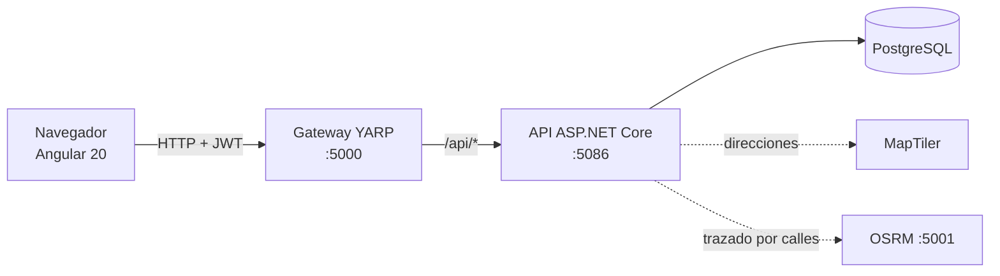
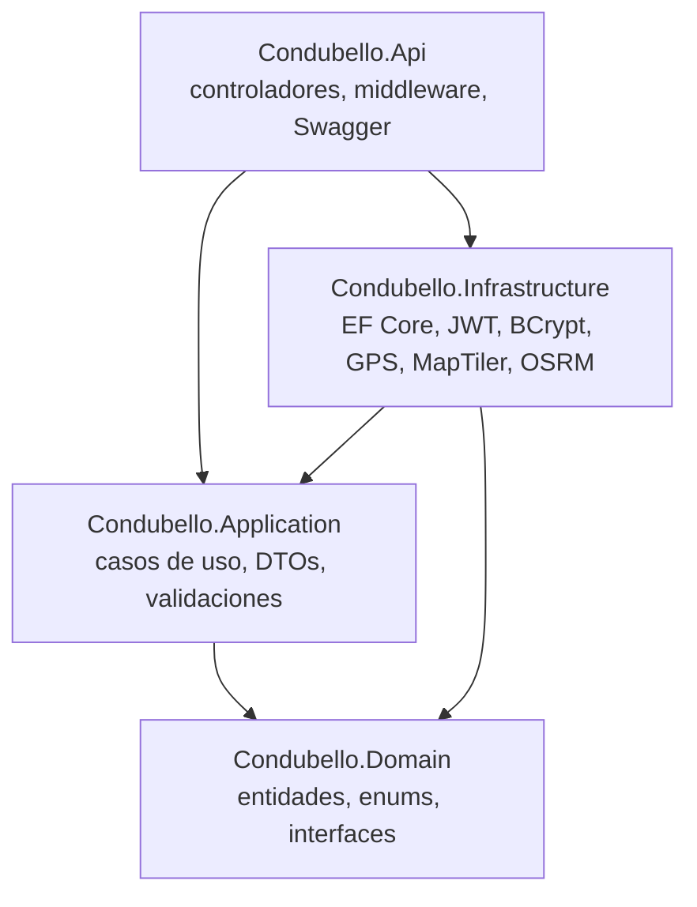
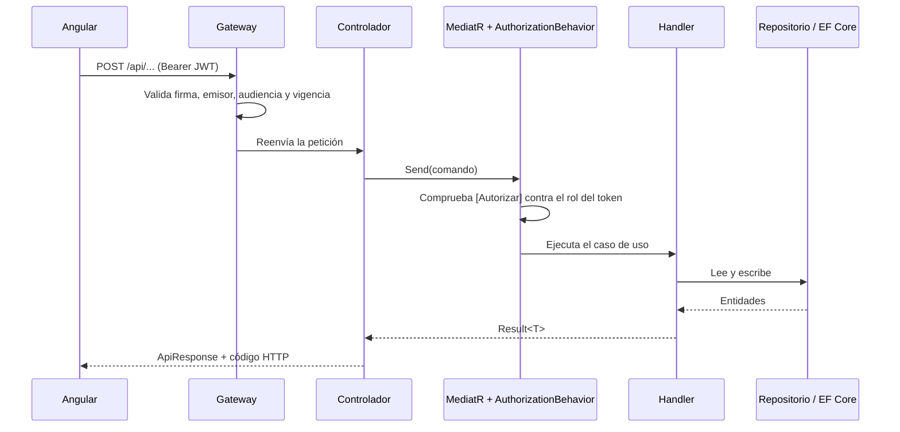

# Condubello

Sistema de gestión para una **escuela de conducción**: administra estudiantes, instructores, vehículos, sesiones prácticas, rutas autorizadas y la telemetría GPS de cada prueba, con control de acceso por rol.

## Contenido

1. [Descripción general](#1-descripción-general)
2. [Instalación y configuración](#2-instalación-y-configuración)
3. [Arquitectura y diseño](#3-arquitectura-y-diseño)
4. [Documentación de la API](#4-documentación-de-la-api)
5. [Despliegue](#5-despliegue)

---

## 1. Descripción general

### Propósito

Condubello permite a una academia de conducción:

- **Estudiantes:** registrarse, ver sus resultados y agendarse en las actividades de la academia.
- **Instructores:** consultar sus estudiantes y vehículos, y gestionar sus tareas (clases y evaluaciones).
- **Administrativos:** administrar el personal, la flota de vehículos, las rutas autorizadas y la sincronización del GPS con los resultados de telemetría de los estudiantes.

### Tecnologías principales

| Capa | Tecnología |
|---|---|
| Backend | .NET 10, ASP.NET Core, MediatR 14, Mapster 10, Entity Framework Core 10 |
| Base de datos | PostgreSQL 15 (Npgsql, columnas `jsonb` para GeoJSON y telemetría) |
| Gateway | YARP (Yarp.ReverseProxy 2.3) con validación de JWT |
| Frontend | Angular 20, Angular Material 20, RxJS, MapLibre GL |
| Seguridad | JWT (Bearer) y BCrypt para contraseñas |
| Servicios externos | MapTiler (geocodificación) y OSRM (rutas por calles) |
| Contenedores | Docker y Docker Compose |

### Estado actual

## 2. Instalación y configuración

### Requisitos previos

| Herramienta | Versión | Para qué |
|---|---|---|
| .NET SDK | 10 | Compilar y ejecutar la API y el gateway |
| Node.js y npm | Node 20.19 o superior | Frontend Angular |
| PostgreSQL | 15 o superior, puerto 5432 | Base de datos |
| Git | Cualquiera | Clonar el repositorio |
| Docker | Opcional | OSRM (rutas por calles) o despliegue completo |
| Clave de MapTiler | Opcional, se crea en https://cloud.maptiler.com | Búsqueda de direcciones |

### Pasos

El flujo en ejecución es `Angular (4200) → Gateway (5000) → API (5086) → PostgreSQL`. Abre una terminal por servicio, en la raíz del repositorio.

**1. Clonar**

```bash
git clone <url-del-repositorio> Condubello
cd Condubello
```

**2. Crear la base de datos**

Crea una base de datos llamada `Condubello` (por ejemplo con pgAdmin o `createdb -U postgres Condubello`).

La conexión está en `Condubello.Api/appsettings.json`:

```
Host=localhost;Port=5432;Database=Condubello;Username=postgres;Password=12345
```

Ajusta la contraseña si la tuya es distinta. En desarrollo las migraciones se aplican solas al iniciar la API (`Database:MigrateOnStartup` en `appsettings.Development.json`).

**3. Configurar la clave de MapTiler (opcional)**

Sin clave, las direcciones no se pueden obtener: las tablas de Rutas y Telemetría muestran coordenadas en lugar de calles. El resto del sistema funciona. Guarda la clave en los secretos de usuario de .NET, que quedan fuera del repositorio:

```bash
dotnet user-secrets set "MapTiler:ApiKey" "tu-clave" --project Condubello.Api
```

Los secretos de usuario se cargan solo en el entorno de desarrollo. Reinicia la API después de guardarla.

**4. Ejecutar la API**

```bash
cd Condubello.Api
dotnet run --launch-profile http
```

Queda en http://localhost:5086, con Swagger en http://localhost:5086/swagger.

**5. Ejecutar el gateway**

```bash
cd Condubello.Gateway
dotnet run --launch-profile http
```

Queda en http://localhost:5000. Es el único punto de entrada del frontend.

- `Jwt:Key` del gateway debe ser **idéntica** a la de la API. En desarrollo ya coinciden en los `appsettings.Development.json` de ambos proyectos.
- La dirección de la API se cambia en `ReverseProxy:Clusters:api:Destinations` de `Condubello.Gateway/appsettings.json`.
- `GET /health` comprueba que está activo.

**6. Ejecutar el frontend**

```bash
cd Condubello.Web
npm install      # solo la primera vez
npm start
```

Queda en http://localhost:4200. La dirección del gateway está en `Condubello.Web/src/app/core/config.ts` (`API_URL`).

**7. Motor de rutas por calles (opcional)**

El trazado por calles de las rutas usa OSRM. Prepara los datos una sola vez (descarga el mapa de Colombia y necesita unos 4 GB de RAM libres) y levanta el contenedor:

```bash
bash docker/osrm/preparar-osrm.sh
docker compose --profile routing up -d osrm
```

OSRM queda en http://localhost:5001, que es el valor de `Osrm:BaseUrl` en `Condubello.Api/appsettings.json`.

**8. Acceso inicial**

- Correo: `admin@condubello.com`
- Contraseña: `Admin123*`

El administrador se crea al primer arranque si no existe ningún administrativo. Los estudiantes se registran solos desde la pantalla de registro y quedan pendientes hasta que un administrativo los apruebe.

### Variables de configuración

| Clave | Dónde | Descripción |
|---|---|---|
| `ConnectionStrings:DefaultConnection` | API | Cadena de conexión a PostgreSQL |
| `Jwt:Key` | API y gateway | Clave de firma, mínimo 32 caracteres, igual en ambos |
| `Jwt:Issuer`, `Jwt:Audience` | API y gateway | Emisor y audiencia del token |
| `Jwt:ExpiraMinutos` | API | Duración del token (480 por defecto) |
| `Seed:AdminEmail`, `Seed:AdminPassword` | API | Administrador inicial |
| `Database:MigrateOnStartup` | API | Aplica migraciones al arrancar |
| `MapTiler:ApiKey` | API | Clave de geocodificación |
| `Osrm:BaseUrl`, `Osrm:RadioAjusteMetros` | API | Motor de rutas por calles |
| `Cors:Origins` | Gateway | Orígenes del frontend permitidos |
| `ReverseProxy:Clusters:api:Destinations` | Gateway | Dirección de la API |

---

## 3. Arquitectura y diseño

### Vista general



El navegador solo habla con el gateway. El gateway valida el JWT, centraliza el CORS y deja pasar sin token solo `login` y `registro`. La API aplica además las reglas de rol de cada caso de uso.

### Capas del backend



La regla de dependencia apunta hacia el dominio: `Domain` no depende de nada y `Application` solo conoce interfaces (`IRepository`, `IUnitOfWork`, `IGpsProvider`…) que `Infrastructure` implementa.

### Estructura de carpetas

```
Condubello/
├── Condubello.slnx             Solución (Api, Application, Domain, Infrastructure, Gateway)
├── Condubello.Domain/          Núcleo, sin dependencias
│   ├── Common/                 BaseEntity, Persona, Roles
│   ├── Entities/               Estudiante, Instructor, Administrativo, Vehiculo, Ruta,
│   │                           SesionPractica, TelemetriaPrueba, ValidacionAntifraude,
│   │                           ControlHorasEstudiante, GeocodificacionCache
│   ├── Enums/                  Rol, EstadoPrueba, EstadoVehiculo
│   └── Interfaces/             IRepository<T>, IUnitOfWork
├── Condubello.Application/     Lógica de negocio
│   ├── Common/
│   │   ├── Behaviors/          AuthorizationBehavior (filtro de MediatR por rol)
│   │   ├── Handlers/           GetAll / GetById / Delete genéricos
│   │   ├── Interfaces/         ICurrentUser, IJwtTokenGenerator, IPasswordHasher,
│   │   │                       IGpsProvider, IGeocodingProvider, IRoutingProvider
│   │   ├── Results/            Result<T> (éxito o fallo tipado)
│   │   ├── Security/           Atributo [Autorizar]
│   │   └── Extensions/         JsonHelper, DateTimeExtensions
│   ├── Features/               Un módulo por funcionalidad (Commands, Queries, Dtos)
│   └── Mappings/               Configuración de Mapster
├── Condubello.Infrastructure/  Implementaciones técnicas
│   ├── Persistence/            ApplicationDbContext, Configurations, Migrations, DbSeeder
│   ├── Repositories/           Repository<T> genérico
│   ├── Auth/                   JWT y BCrypt
│   ├── Gps/                    SimulatedGpsProvider
│   ├── Geocoding/              Cliente de MapTiler
│   └── Routing/                Cliente de OSRM
├── Condubello.Api/             Controladores REST, middleware de excepciones, Swagger
├── Condubello.Gateway/         Proxy inverso YARP con validación de JWT
├── Condubello.Web/             Frontend Angular
│   └── src/app/
│       ├── core/               Autenticación, guards, interceptores, cliente HTTP
│       ├── layout/             Estructura con menú lateral
│       └── features/           login, dashboard, actividades, resultados, mapa,
│                               cuenta y crud (módulos declarativos)
├── docker/                     Dockerfiles, nginx y preparación de OSRM
├── docker-compose.yml          Postgres, API, gateway, web y OSRM (opcional)
└── .env.example                Plantilla de variables para Docker
```

### Funcionamiento interno

**Ciclo de una petición.** Un controlador no contiene lógica: construye un comando o consulta de MediatR y lo envía. Antes de ejecutar el caso de uso, `AuthorizationBehavior` lee el atributo `[Autorizar(Rol...)]` y devuelve "prohibido" si el rol del token no está permitido. El handler trabaja con repositorios, guarda con `IUnitOfWork` y devuelve un `Result<T>`. El controlador lo convierte en código HTTP y en el envoltorio `ApiResponse`.



**Visibilidad por rol.** Los handlers de lectura heredan de `GetAllHandler` y sobrescriben `Filtro()` para limitar los datos:

| Rol | Estudiantes | Sesiones prácticas |
|---|---|---|
| Estudiante | Solo su propio registro | Solo las suyas |
| Instructor | Solo los que tienen sesiones con él | Solo las suyas |
| Administrativo | Todos | Todas |

**Sincronización de GPS.** `POST api/telemetria/sincronizar` toma las sesiones en curso o completadas (o una sola), pide los puntos a `IGpsProvider`, guarda el recorrido como GeoJSON `LineString` en `telemetria_pruebas.ruta_gps` y marca `alerta_desviacion` si algún punto queda a más de 150 m de la ruta autorizada de la sesión. La distancia se calcula contra los segmentos de la ruta con una aproximación equirectangular, suficiente para distancias cortas.

**Rutas.** Una ruta es un GeoJSON autorizado. El administrativo la dibuja en el mapa (`ruta-picker`), puede calcular el trazado por calles entre dos puntos con OSRM y ajustar una ruta existente a las calles. La geocodificación de MapTiler se guarda en `geocodificacion_cache` para no repetir consultas.

**Frontend.** `features/crud/modules.ts` define cada módulo (columnas, formularios, permisos por rol y acciones) y una sola pantalla genérica (`crud-page`) los muestra todos. El menú lateral y los guards de ruta salen de esa misma lista.


### Decisiones técnicas y patrones

| Decisión | Justificación |
|---|---|
| **Arquitectura limpia en cuatro proyectos** | Mantiene la lógica de negocio independiente de la base de datos y del framework web, y permite cambiar una implementación (por ejemplo el proveedor GPS) sin tocar los casos de uso. |
| **CQRS ligero con MediatR** | Cada caso de uso es una clase pequeña y aislada. Los controladores quedan delgados y las reglas transversales (autorización) se aplican en un único punto. |
| **Behavior de autorización con `[Autorizar]`** | Los permisos se declaran junto al caso de uso y se cumplen aunque alguien llame al handler sin pasar por el controlador. |
| **Patrón Resultado (`Result<T>`)** | Los errores esperados (no encontrado, conflicto, validación, prohibido) son valores, no excepciones. El controlador los traduce a 404, 409, 400 o 403 de forma uniforme. |
| **Repositorio genérico + Unit of Work** | Evita repetir el CRUD y deja a los handlers dependiendo de interfaces del dominio. |
| **Handlers base (`GetAll`, `GetById`, `Delete`)** | El CRUD de cada módulo es de pocas líneas, y el filtrado por rol se hace sobrescribiendo `Filtro()`. |
| **Mapster** | Mapeo entre entidades y DTOs sin código manual repetitivo, con reglas propias donde hace falta (por ejemplo, GeoJSON). |
| **Gateway YARP** | Un solo punto de entrada: valida el JWT una vez, centraliza el CORS y permite no exponer la API fuera de la red interna. |
| **JWT + BCrypt** | Autenticación sin estado y contraseñas con hash adaptativo. |
| **PostgreSQL con `jsonb`** | GeoJSON y telemetría son documentos de forma variable; `jsonb` los guarda sin crear tablas por cada campo. |
| **Interfaces para GPS, geocodificación y rutas** | Los servicios externos se pueden sustituir o simular. El GPS es simulado por decisión del proyecto. |
| **Caché de geocodificación en base de datos** | Reduce las consultas a MapTiler y su costo. |
| **Frontend con módulos declarativos** | Un solo componente genérico cubre ocho módulos de administración, lo que reduce código y mantiene la interfaz consistente. |
| **Angular standalone con carga diferida** | Menor tamaño de carga inicial y sin módulos de NgModule que mantener. |

---

## 4. Documentación de la API

La documentación interactiva está en Swagger: http://localhost:5086/swagger (solo en desarrollo, directamente sobre la API). Desde el frontend, todas las llamadas pasan por el gateway en `http://localhost:5000`.

### Convenciones

- **Autenticación:** cabecera `Authorization: Bearer <token>`. El token se obtiene en `POST /api/auth/login`.
- **Formato de respuesta:** todas las respuestas usan el mismo envoltorio.

```json
{
  "success": true,
  "message": "Vehículos obtenidos correctamente.",
  "data": [],
  "errors": [],
  "warnings": []
}
```

- **Errores:** `errors` lista los fallos por campo (`{ "campo": "placa", "mensaje": "..." }`). `warnings` trae avisos que no impiden la operación.
- **Códigos HTTP:** `200` y `201` en éxito; `400` validación; `401` sin sesión; `403` sin permiso; `404` no encontrado; `409` conflicto (por ejemplo, placa duplicada o cruce de horario).
- **Identificadores:** UUID. **Fechas:** ISO 8601 en UTC.

### Autenticación

| Método | Ruta | Acceso | Descripción |
|---|---|---|---|
| POST | `/api/auth/login` | Público | Inicia sesión y devuelve el token. Un estudiante no aprobado recibe 403. |
| POST | `/api/auth/registro` | Público | Registro de estudiante; queda pendiente de aprobación. |
| GET | `/api/auth/me` | Autenticado | Datos de la sesión actual. |

### Recursos

Todos los recursos siguen el patrón `GET /`, `GET /{id}`, `POST /`, `PUT /{id}`, `DELETE /{id}` salvo donde se indica. La columna "Escritura" indica quién puede crear, editar y borrar; la lectura requiere sesión y, en estudiantes y sesiones, respeta los filtros por rol de la sección 3.

| Ruta base | Escritura | Operaciones adicionales |
|---|---|---|
| `/api/estudiantes` | Administrativo | `GET /me` (Estudiante); `PUT /me/cuenta` (Estudiante); `PATCH /{id}/aprobar` y `PATCH /{id}/password` (Administrativo) |
| `/api/instructores` | Administrativo | — |
| `/api/administrativos` | Administrativo (lectura también) | — |
| `/api/vehiculos` | Administrativo | `PATCH /{id}/estado` (Administrativo e Instructor) |
| `/api/rutas` | Administrativo | `PATCH /{id}/ajustar-calles` (Administrativo); `POST /calcular-trazado` (Administrativo e Instructor) |
| `/api/sesiones-practicas` | Administrativo | `PATCH /{id}/seguimiento` (Administrativo e Instructor; el instructor solo en sus sesiones) |
| `/api/control-horas` | Administrativo crea y borra; Administrativo e Instructor editan | — |
| `/api/telemetria` | Administrativo | `POST /sincronizar` (Administrativo); `PATCH /{id}/ruta-gps` (Administrativo e Instructor); `GET /{id}/imagen` (SVG del recorrido) |
| `/api/validaciones-antifraude` | Administrativo | — |
| `/api/geocodificacion` | — (solo lectura) | `GET /inversa?lat=&lon=` y `GET /buscar?texto=` (Administrativo e Instructor) |

### Ejemplos

**Iniciar sesión**

```bash
curl -X POST http://localhost:5000/api/auth/login \
  -H "Content-Type: application/json" \
  -d '{"email":"admin@condubello.com","password":"Admin123*"}'
```

**Sincronizar el GPS de una sesión**

```bash
curl -X POST http://localhost:5000/api/telemetria/sincronizar \
  -H "Authorization: Bearer <token>" \
  -H "Content-Type: application/json" \
  -d '{"sesionId":"<uuid-de-la-sesion>"}'
```

Respuesta:

```json
{
  "success": true,
  "message": "Sincronización de GPS finalizada.",
  "data": { "sincronizadas": 1, "conAlerta": 0, "sinDatos": 0 },
  "errors": [],
  "warnings": []
}
```

Sin `sesionId` se sincronizan todas las sesiones en curso o completadas. Si alguna se desvía de su ruta, `warnings` lo indica.

**Cambiar el estado de un vehículo**

```bash
curl -X PATCH http://localhost:5000/api/vehiculos/<uuid>/estado \
  -H "Authorization: Bearer <token>" \
  -H "Content-Type: application/json" \
  -d '{"estadoActual":"EN_MANTENIMIENTO"}'
```

---

## 5. Despliegue

El repositorio incluye un `docker-compose.yml` con todos los servicios.

| Servicio | Imagen | Puerto en el host | Notas |
|---|---|---|---|
| `postgres` | postgres:15-alpine | 5432 | Datos en el volumen `condubello_postgres_data` |
| `api` | `docker/api.Dockerfile` | No se publica | Solo el gateway llega a ella |
| `gateway` | `docker/gateway.Dockerfile` | 5000 | Punto de entrada único de la API |
| `web` | `docker/web.Dockerfile` (nginx) | 8080 | Entrega la SPA compilada |
| `osrm` | osrm/osrm-backend | 5001 | Opcional, perfil `routing` |

### Pasos

1. Copia la plantilla y completa los valores:

```bash
cp .env.example .env
```

2. Define como mínimo `JWT_KEY` (mínimo 32 caracteres; genera una con `openssl rand -base64 48`), `POSTGRES_PASSWORD` y `SEED_ADMIN_PASSWORD`. `MAPTILER_API_KEY` es opcional.

3. Construye y levanta:

```bash
docker compose up -d --build
```

4. Abre http://localhost:8080 e inicia sesión con el administrador definido en `.env`.

5. Opcional, rutas por calles:

```bash
bash docker/osrm/preparar-osrm.sh
docker compose --profile routing up -d osrm
```

Las migraciones se aplican solas al arrancar la API (`Database__MigrateOnStartup`).

### Consideraciones de producción

- **Expón solo el gateway y el frontend.** La API y la base de datos no deben ser accesibles desde internet; en el compose la API no publica ningún puerto.
- **Cambia los secretos:** `JWT_KEY`, la contraseña de PostgreSQL y la del administrador inicial.
- **Dirección del gateway en el frontend:** el frontend usa `http://localhost:5000` (`Condubello.Web/src/app/core/config.ts`). Para publicarlo en otro dominio, cambia `API_URL` y vuelve a construir la imagen `web`; además ajusta `WEB_PORT` o el origen CORS del gateway (`Cors__Origins__0`).
- **HTTPS:** el compose desactiva la redirección HTTPS dentro de los contenedores. Coloca un proxy con certificado delante del gateway y del frontend.
- **Copias de seguridad:** respalda el volumen `condubello_postgres_data`.

### Detener y limpiar

```bash
docker compose down        # detiene y conserva los datos
docker compose down -v     # detiene y borra también la base de datos
```
